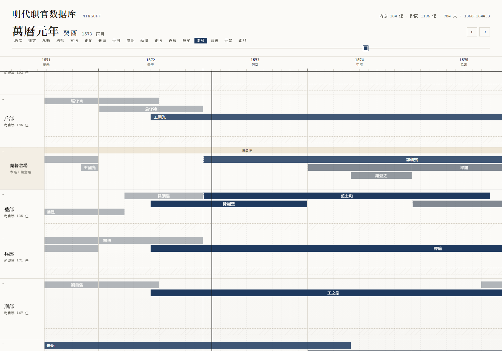

# MingOff —— 明代职官数据库与可视化平台

专注明代（1368–1644）276 年职官的结构化数据库：每条任职记录**可追溯史料来源**，
并显式标注异文与置信度。

> 需求基线（PRD）与竞品调研为本地内部文档，不随本仓发布；
> 本仓只保留实现、数据管线、设计决策与可公开的结构化数据。

---

## 预览




---

## 一、这个项目做什么

| 维度 | 做法 |
|------|------|
| **垂直** | 只做明代职官，不与 CBDB 拼规模 |
| **可溯源** | 每条任职挂一个或多个史料来源（CBDB / 明实录 / 张德信年表…） |
| **可校勘** | 多源冲突进 `discrepancy` 表，是产品功能而非"脏数据" |
| **显式不确定** | `confidence` 字段 + `NULL` 表示史料未载（**不是 0**） |
| **可视化** | 任职时间轴 / 朝堂快照 / 人物流转网（后置，先保证数据对） |

**核心取舍**：不追求"绝对正确"，追求**每条记录都说清自己有多可信、依据是什么**。

---

## 二、当前进度

| 阶段 | 内容 | 状态 |
|------|------|------|
| 阶段① MVP | 崇祯朝兵部尚书：清洗→入库→查询→校勘链路 | ✅ 完成 |
| 阶段①½ demo | 九职位可视化原型（无限画布·月格等宽·实录月份接入） | ✅ 完成（2026-10-16） |
| **正式站** | `site/` 按 demo 模板逐项重做（全朝内阁 + 年号跳转 + 实录抽屉） | ✅ 2026-10-17（D24） |
| **数据重建 v3** | 重解析年表逐年名单（保留无注文行）+ CBDB 修错 + 1644.3 南明剔除 + 画布前移洪武 | ✅ 2026-10-17（D25） |
| 阶段② 中高层全量 | 六部七卿+内阁+督抚+科道；同年多月实录校勘 | ✅ 部院六部+都察院已接站点（D46，2026-10-19）；督抚/科道未做 |
| 阶段③ 全朝中层 | 接入 CBDB 全量 + NLP 半自动抽取 | ⬜ |
| 阶段④ 地方官 | 府州县官 + 卫所武官（百万级） | ⬜ |
| **外部校勘层** | 《明人傳記資料索引》全书 OCR + 人名目录 + 人物库（6,487 人） | ✅ 2026-10-18（D38，尚未对接 MingOff） |

已完成：6 张表 schema、数据存取层、崇祯朝兵部尚书 14 任种子数据、CLI、
**197 个测试**（公开仓 144 通过 + 53 跳过：跳过项依赖不入仓的重建输入）、单文件可视化 demo（`web/demo.template.html` 生成；成品不入公开仓）、
正式站 `site/`（Next.js 静态导出，**184 段 / 163 人全朝内阁**，画布 1368–1644.3），
并已接入部院六部+都察院（**1,196 段 / 789 实体**，D46）。

> ✅ **数据源问题已处理（D25）**：旧版丢“无注文人名行”导致 360 段事件碎片；
> 本轮重写表格解析后，人-年 594 → 1,039、段 360 → 192（连续任期），
> 起月覆盖 47% → 98%；CBDB 旧错挂 5 处已修（楊士奇/楊溥/曹鼐/張孚敬/方逢年），
> 1644.3 之后的南明任命已剔除。详见 `docs/正式数据管线报告.md` 第八节。
> 人物抽屉已接入 **CBDB 小传**（生卒/籍贯/字号/历任）+ CBDB/中研院直达链接；
> 重复人-年（1402 解縉、1441 曹鼐）已去重，解縉据原书补 1403 后为 1402–1407 单段。
> 2026-10-18 又修一组「年份头被并进上一年末行」导致的漏年：吳道南 1616、曹鼐 1440、
> 殷士儋 1571、許國 1583、胡廣 1412（均回原书页核对，见管线报告第九节）。
> **部院 v3（D31/D32/D33，D46 后）**：1,196 段 / 789 实体（784 姓名）/ 3,471 人-年，
> 伪名/注文错挂/重复条目/CBDB 多正名清零，G6 审计通过；**不同衙署不合并**
> （御史臺/都察院/御史府、總督京儲/總督倉場/總倉場各自独立，沿革关系只写入文档）；
> 仍残留 120 段长缺口（显式 `gap_after`）与各衙缺年。
> **已接站点（D46，2026-10-19）**：六部+都察院 8 行（六部可折叠、预留侍郎泳道），
> 御史系列/倉場系列分组 + 分期名带；倉場归戶部子行；D-11 灰显、同名 `person_label`、
> 原书页码/缺口年已入抽屉。
> 数据接入硬规则见 [数据接入规范](docs/数据接入规范.md)（D26）；
> PDF→OCR 这一段见 [年表PDF_OCR规范](docs/年表PDF_OCR规范.md)（D27）；
> 后续表种与发布节奏见 [发展路线](docs/发展路线.md)。
demo 要点：**月格等宽无限画布**（拖滑块精确到月看"那一年那月在任"）、
皇帝行朱色 + 周岁年龄带、实录月份回填 + 抽屉贴《明实录》原文。
本轮开发经验见 `docs/demo开发经验总结.md`。

---

## 三、快速上手

```powershell
cd mingoff
$env:PYTHONPATH="src"          # 或先 pip install -e ".[dev]"

python -m mingoff.cli init      # 建库
python -m mingoff.cli seed      # 导入崇祯朝兵部尚书 14 任
python -m mingoff.cli list-bingbu
```

输出（MVP 的核心验收场景）：

```
兵部尚书历任（共 14 任）

#   姓名       任期           类型    离任     置信度
--------------------------------------------------------
1   閻鳴泰      1627–1628    实授    罢免     0.8
...
4   申用懋      1629–1629    署理    迁转     0.7
...
14  張縉彥      1644–1644    实授    降贼     0.8
```

### 其他命令

```powershell
python -m mingoff.cli snapshot 1629      # 某年在任快照
python -m mingoff.cli person 楊嗣昌       # 某人的仕途流转（含来源）
python -m mingoff.cli todo               # 待校勘队列
python -m mingoff.cli stats              # 库内计数
python -m mingoff.backfill_months        # 实录月份回填（需 sinica_months.json，本地数据，不入公开仓）
python -m mingoff.export_demo            # 重建 web/demo.html（产物不入公开仓）
python -m mingoff.official               # 重建正式站数据（需 vol1_* 重建输入，不入公开仓；见 MAINTAINERS.md）
python -m pytest tests                   # 197 个测试（公开仓 144 通过 / 53 跳过）
python scripts/check_public_scope.py     # 公开仓范围自检
```

---

## 四、数据模型

六张表，详见 `src/mingoff/schema.py`。

```
person ──┐
         ├──< tenure >──┐
office ──┘              ├──< tenure_source >── source
                        └──< discrepancy >──── source(a/b)
```

| 表 | 作用 | 关键点 |
|----|------|--------|
| `person` | 人物 | `cbdb_id` 对齐外部库；生卒年可空 |
| `office` | 官职 | `parent_office_id` 构成官职树（兵部→兵部尚書） |
| `tenure` | **任职（核心）** | `tenure_type` 区分实授/署理/加衔；`confidence` 显式不确定 |
| `source` | 史料来源 | 带 `url` 以支持"一键跳原文出处" |
| `tenure_source` | 任职↔来源 | 一条任职可挂多源 |
| `discrepancy` | 异文/待校 | 多源冲突是一等公民 |

### 三条贯穿全项目的规则

1. **`NULL` ≠ `0`**。史料未载就是 `NULL`。写 0 会被误读成"生于公元 0 年"，
   是最常见也最难发现的录入错误。
2. **一条任职可挂多个来源**。单一 `source_ref` 字段表达不了"《明实录》与 CBDB
   都记了这条"。
3. **不确定性显式**。`confidence` 不用 1.0（除非真的无歧），冲突进 `discrepancy`。

---

## 五、为什么这些设计（决策记录）

完整理由见 `docs/DECISIONS.md`，几条要点：

- **为什么用 SQLite 而不是 PRD 建议的 PostgreSQL**：MVP 单人开发，SQLite 省掉部署；
  schema 用标准 SQL 写，迁移时只换连接层。
- **为什么不用 ORM**：表少、查询以只读统计为主，原生 SQL 更容易看出"哪些字段是
  史料未载"。而 `NULL` 语义正是本项目最需要小心的地方。
- **为什么 `tenure` 是核心表而不是 `person`**：本项目的价值在"某人某时任何职"。
- **为什么去重按 (姓名+籍贯) 而非仅姓名**：明代同名者众，误合并比留两份更糟。

---

## 六、与 `guji-pipeline` 的关系

MingOff 是独立产品，但**复用父项目的古籍取文能力**做校勘：

```powershell
# 在父项目里取《明实录》某卷原文，用于核对任职记载
cd ..
python -m guji.cli shidian toc LS0026        # 明實錄 3118 章
python -m guji.cli shidian chapter LS0026 <chapterId>
```

父项目的 `catalog find` / `shidian chapter` 提供"现取现核"的原文出处，
**不把明实录全文搬进本库**（PRD 4.3 的合规硬约束）。

> 实测结论：识典《明實錄》书 ID = `LS0026`，3118 章（PRD 4.2 写 2909 卷，
> 章数口径不同），章节页一次请求即可拿到完整目录，无需 JS 交互枚举。

---

## 七、目录结构

```
mingoff/
├─ README.md              本文件
├─ docs/DECISIONS.md      设计决策记录（D1–D42）
├─ docs/demo开发经验总结.md  本轮 demo 开发的坑与方法
├─ docs/数据源月份精度实测.md  CBDB/中研院月份能力实测
├─ docs/数据接入规范.md    ★ 数据接入硬规则（D26：解析/实体/时间/校验门 G1–G6）
├─ docs/年表PDF_OCR规范.md  ★ PDF→OCR 规范（D27：页码校准/切片/版式/校验门 O1–O7）
├─ docs/发展路线.md        分阶段方向（P0 收尾 → P1 中书省 → P2 殿阁+首辅 → …）
├─ docs/明人传记资料索引评估.md  工具书调研：人物校勘/出处层（L4）评估
├─ docs/明人传记资料索引OCR与核验报告.md ★ 全书 963 页 OCR 与首轮核验（D38）
├─ docs/明人传记资料索引_人名目录核对报告.md ★ 目录 9,651 人对校、CBDB 裁决、置信分层（D38）
├─ docs/人物数据库试点报告.md  ★ 6,487 人字段抽取、与 CBDB 逐字段对账、净增量（D38）
├─ docs/ming-official-atlas调研.md  对标调研：大明职官图（可借鉴的 10 条）
├─ docs/部院数据接收报告.md    ★ 部院 v1 质检→v3 修复与站点接入评估（D30–D33）
├─ docs/部院数据待办清单.md    ★ 部院 v2 残留待办（身份/注文/缺口/表头/CBDB/页码）
├─ docs/部院D03原书核对报告.md  ★ D-03 长缺口/缺年原书页核对（筛查完成，13 页证/104 screened）
├─ docs/部院D08页码索引.md      ★ 277 年 year→book_page 索引（100% 条目有页）
├─ docs/部院D04表头核对报告.md   ★ D-04 表头/对页版式原书核对（只出证据，不改数据，D40）
├─ docs/重建数据操作步骤.md  v3 数据重建的脚本与口径
├─ pyproject.toml         包定义（一期零第三方依赖）
├─ src/mingoff/
│  ├─ schema.py           6 张表 + 受控词表
│  ├─ db.py               连接与建库
│  ├─ repo.py             数据存取（含三条规则的落实）
│  ├─ seed.py             MVP 种子数据（崇祯朝兵部尚书）
│  ├─ chronology.py       干支/年号/周岁
│  ├─ timeline.py         月格等宽时间轴（Python 侧基准）
│  ├─ shilu.py            明实录出處列年月解析
│  ├─ backfill_months.py  实录月份回填（同年唯一记录才回填）
│  ├─ merge_demo_data.py  研究数据 + ground truth 合并
│  ├─ export_demo.py      导出内嵌 JSON 并产出单文件 demo
│  ├─ official.py         ★ 正式数据管线：重解析条目→任职段（D21/D25；v3）
│  ├─ build_person_profiles.py  内阁+部院 CBDB→人物小传（D46 扩展，按 person_id）
│  └─ cli.py              命令行入口
├─ web/demo.template.html ★ demo 模板 —— 正式站的 **UI 唯一真源**（D24）
├─ web/demo.html          产出的单文件 demo（生成物，不入公开仓，D21）
├─ src/mingoff/data/vol1_entries.json     年表逐年名单（人-年，重解析，数据资产）
├─ src/mingoff/data/vol1_person_cbdb.json 人物→CBDB 映射（v3 修错版）
├─ src/mingoff/data/person_profiles.json  CBDB 人物小传（内阁 163 人，抽屉展示）
├─ src/mingoff/data/person_profiles_buyuan.json  ★ 部院小传（789 实体 / 546 有 id；D46）
├─ src/mingoff/data/official_cabinet.json 正式版导出（tenures + shilu）
├─ src/mingoff/data/official_buyuan.json  ★ 部院导出（12 衙 / 1,196 段；D46 接站）
├─ src/mingoff/data/mrzj/   《明人傳記資料索引》资产（本地留存，不入公开仓）
├─ scripts/mrzj/            该书从切片→OCR→解析→人物库的 18 个脚本（本地留存，不入公开仓）
├─ _stage_mrzj.py           该书产出归档脚本（本地留存，不入公开仓）
├─ MAINTAINERS.md          ★ 仓库分工与公开范围自检（本地维护用）
├─ scripts/public_scope.py  公开仓排除规则；scripts/check_public_scope.py 自检
├─ docs/正式数据管线报告.md  正式版产出规模、源复核与 v3 重建报告
├─ site/                  ★ 正式网站（Next.js 静态导出，D22/D24；D46 接入部院；见 site/README.md）
│  ├─ src/lib/rows.ts     展示层行/泳道配置（六部折叠、御史/倉場分期名带）
│  └─ src/data/buyuan.json 部院数据副本（1.2MB）
│     src/data/person_profiles_buyuan.json 部院小传副本（0.9MB）
└─ data/mingoff.sqlite    运行时数据库（不入库）
```

---

## 八、合规与许可

- **代码**：Apache-2.0（见 [`LICENSE`](LICENSE)、[`NOTICE`](NOTICE)）；
- **本项目整理的结构化数据 / CBDB 衍生数据**：**CC BY-NC-SA 4.0**
  （署名 + 非商业 + 相同方式共享，见 [`DATA_LICENSE.md`](DATA_LICENSE.md)）；
- **第三方来源与边界**：张德信《明代职官年表》、CBDB、中研院《明實錄》检索、
  识典古籍、《明人傳記資料索引》——见 [`THIRD_PARTY.md`](THIRD_PARTY.md)；
  原书扫描页、逐页 OCR、CBDB 快照不随公开仓发布；
- **主数据走 CBDB 官方快照**（官方支持研究用途）；
- 识典 / 中研院仅作**在线出处与校勘链接**，不批量搬全文入自建库；
- 网站发布做来源标注与许可声明；数据许可与代码许可分开声明；
- 引用格式见 [`CITATION.cff`](CITATION.cff)。
