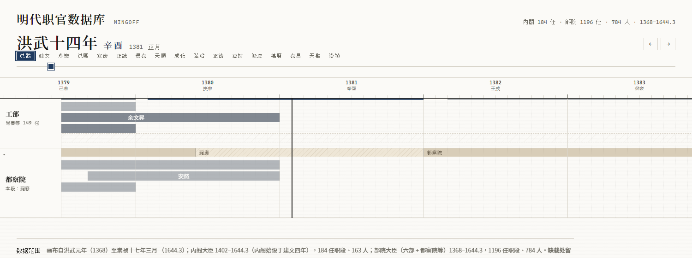

# MingOff · 明代职官数据库

> 一个面向研究、教学与可视化的明代（1368–1644）职官任职数据库：**每条任职记录都带来源、置信度与异文标记**。
>
> 代码 Apache-2.0 · 整理数据 CC BY-NC-SA 4.0 · 非商业研究项目

[](https://github.com/Tomorin-1122/mingoff/actions/workflows/ci.yml)
[](LICENSE)
[](DATA_LICENSE.md)
[](https://github.com/Tomorin-1122/mingoff/releases)




---

## 一、这是什么

MingOff 把明代职官年表中的逐年名单，整理成可查询、可校勘、可视化的结构化数据。
它不追求“唯一正确”的答案，而是让每条记录说清楚三件事：

1. **依据是什么**（原书页、CBDB、实录检索）；
2. **有多确定**（置信度、异文、缺载）；
3. **不同史料哪里不一致**（冲突显式保留，而不是清洗掉）。

适用于：

- 历史研究中的职官履历检索、人物关系与任期核对；
- 高校历史课程/数字人文教学中的数据案例；
- 开发者构建时间轴、知识图谱、检索与可视化应用。

## 二、数据概览

| 数据集 | 时间范围 | 规模 |
|---|---|---|
| 内阁大臣 | 1402–1644.3 | 184 任职段 / 163 人 / 1,040 人-年 |
| 部院大臣（六部 + 都察院等 12 衙） | 1368–1644.3 | 1,196 任职段 / 789 实体 / 3,471 人-年 |
| 人物小传（CBDB 对齐） | — | 789 实体；546 有 CBDB id |
| 《明實錄》相关命中 | — | 内阁 155 人 / 9,695 条；部院 130 人 / 3,913 条 |

- 画布断限：**崇祯十七年三月（1644.3）**；此后南明任命不收。
- 部院 12 衙：吏部、戶部、禮部、兵部、刑部、工部、都察院、御史臺、御史府、
  總督京儲、總督倉場、總倉場（不同衙署/表头各自独立，不合并实体）。
- 内阁与部院分两套 JSON 导出；站点将御史系列、倉場系列合并为行内分期展示，
  数据层仍保留原书表头。

## 三、核心设计

| 原则 | 做法 |
|---|---|
| **可溯源** | 每条记录带原书页码；人物带 CBDB id；实录命中带出处 |
| **可校勘** | 多源冲突、异文、注文错挂进入 `discrepancy` / review，不静默丢弃 |
| **显式不确定** | `confidence` 0.5–0.8；史料未载写 `NULL`，**不写 0** |
| **年在位体** | 年表某年列名 = 该年在任；缺载年留空，不插值 |
| **同名不误合** | 同名多实体用 `person_id` 拆分（如 顧佐#1 / 顧佐#2） |
| **归属可核** | 对页无标签年按行序推断的段标 `office_status`，站点灰显提示回原书核 |

> 重要：`NULL` 表示“史料未载”，不是“0”或“不存在”。引用前请回原书页核对。

## 四、数据从哪里来

| 来源 | 用途 | 说明 |
|---|---|---|
| 张德信《明代職官年表》（黄山书社） | 内阁、部院逐年名单 | 本项目的底本；原书扫描/OCR **不在本仓** |
| China Biographical Database（CBDB） | 人物对齐、生卒/籍贯/历任小传 | 使用快照 `cbdb_20261010`；SQLite 快照不入仓 |
| 中研院「明代職官資料庫」/《明實錄》 | 任职相关实录命中 | 仅保留与任期相关的命中摘要与出处，不批量搬全文 |
| 识典古籍 | 在线出处/卷次链接 | 仅链接，不抓取全文 |
| 《明會要》《吾學編》《憲章類編》《建文年譜》等 | 沿革与编年校勘 | 公有领域古籍，短引并注明卷次 |

完整署名与再分发边界见 **[THIRD_PARTY.md](THIRD_PARTY.md)** 与 **[DATA_LICENSE.md](DATA_LICENSE.md)**。

## 五、站点

`site/` 是 Next.js 静态导出站点，主要能力：

- 月格等宽的全朝时间轴（1368–1644.3），可拖滑块、按年号跳转；
- 内阁 + 六部 + 都察院 8 个一级行；六部可折叠，预留侍郎等副貳泳道；
- 御史系列（御史臺/都察院/御史府）与倉場系列（京儲/倉場/總倉場）行内分期名带；
- 当前月高亮、同人跨行联动、任期详情抽屉；
- 抽屉展示：任期、置信度、离任、原书页、归属依据、年表原文、CBDB 小传、实录命中；
- 对页推断段与同年并格等待校信息以灰显/虚线提示。

本地预览：

```bash
cd site
pnpm install
pnpm build
npx serve out -l 3456
```

部署：静态产物在 `site/out/`，可部署到任意静态托管（Vercel / GitHub Pages / Nginx）。

线上地址：**<https://tomorin-1122.github.io/mingoff/>**（GitHub Pages 自动构建，推送 `main` 即更新）。

## 六、数据格式

`src/mingoff/data/official_cabinet.json` / `official_buyuan.json`：

```json
{
  "meta": { "dataset": "...", "license": "CC BY-NC-SA 4.0", "source": "...", "stats": {} },
  "tenures": [
    {
      "person": "于謙",
      "person_id": "于謙",
      "person_label": "于謙",
      "cbdb_id": 12345,
      "office": "兵部",
      "office_status": "mixed",
      "tenure_type": "实授",
      "start_year": 1449,
      "start_month": 8,
      "end_year": 1457,
      "end_month": 1,
      "confidence": 0.8,
      "leave": "奪門",
      "note": "……年表原文……",
      "start_book_page": 484,
      "end_book_page": 492,
      "years": [1449, 1450, 1451, 1452, 1453, 1454, 1455, 1456, 1457]
    }
  ],
  "shilu": { "于謙": { "count": 3, "hits": [] } }
}
```

| 字段 | 含义 |
|---|---|
| `person_id` / `person_label` | 同名拆分后的实体键与展示名（部院数据） |
| `office` / `office_status` | 衙署；归属依据（page-verified / name-anchor / row-order / mixed / null） |
| `start_year` / `start_month` | 起点；`month = null` 表示仅到年 |
| `tenure_type` | 实授 / 署理 |
| `confidence` | 0.5–0.8，越低越需回原书核 |
| `leave` | 离任原因（年表注文；未载为“未載”） |
| `note` | 年表原文（短引；用于校勘） |
| `gap_years` | 1–2 年 OCR 缺行合并的缺口年，非连续在任 |
| `start_book_page` / `end_book_page` | 原书页码 |
| `shilu` | 与本人任期相关的《明實錄》命中（最多 8 条 + 总数） |

人物小传：`person_profiles.json`（内阁，按姓名）与
`person_profiles_buyuan.json`（部院，按 `person_id`），字段含生卒、籍贯、字号、
入仕、历任（最多 30 条 + 总数）。

## 七、本地开发

```bash
git clone https://github.com/Tomorin-1122/mingoff.git
cd mingoff

# Python 测试（数据资产已随仓提供）
PYTHONPATH=src python -m pytest tests -q

# 站点
cd site
pnpm install
pnpm build
```

运行环境：Python 3.13+、Node.js 24+、pnpm 11+。

项目结构：

```
mingoff/
├─ src/mingoff/          数据管线、schema、校勘与导出
├─ src/mingoff/data/     最终结构化数据（4 个 JSON）
├─ tests/                核心数据与几何测试
├─ site/                 Next.js 静态站点（含站点用 JSON）
├─ assets/screenshots/   README 截图
└─ .github/workflows/    CI（测试 + 站点构建）
```

## 八、已知限制

- 年表是「年在位」体，**不保证精确到月**；月份缺载时站点按整年显示并在抽屉注明。
- 史料缺载、OCR 误识、同名人物、对页续行等会造成缺口或归属不确定；相关段已用
  `office_status`、`gap_years`、低 `confidence` 显式标记，但**引用前仍应回原书页核对**。
- 人物小传来自 CBDB，CBDB 本身可能有生卒/职官记录缺漏；小传只做搬运，不做史实推断。
- 实录命中是“与任期相关”的检索结果，不等于逐条任职证据；判定就任/离任仍需读原文。
- 本项目为学术/非商业用途，不保证数据完整无误。

## 九、许可与引用

| 层 | 许可 |
|---|---|
| 代码（Python/TS/构建配置） | **Apache-2.0** |
| 本项目整理的结构化数据 / CBDB 衍生数据 | **CC BY-NC-SA 4.0** |
| 第三方原始资料 | 权利归原权利人；本仓不发布扫描页、逐页 OCR、CBDB 快照 |

- 代码：见 [LICENSE](LICENSE) 与 [NOTICE](NOTICE)；
- 数据：见 [DATA_LICENSE.md](DATA_LICENSE.md)；
- 第三方署名：见 [THIRD_PARTY.md](THIRD_PARTY.md)；
- 引用格式：见 [CITATION.cff](CITATION.cff)。

建议引用：

> MingOff contributors. *MingOff：明代職官數據庫*（2026）.
> https://github.com/Tomorin-1122/mingoff

## 十、参与贡献

欢迎 Issue / PR，尤其是：

- 带原书页证据的职官校正、异文与缺口补正；
- 检索、可视化、数据格式与文档改进；
- 新表种（殿阁/首辅、地方官等）的 schema 讨论。

数据修正请附**原书页码或可核对的出处**；请勿提交受版权保护的整页扫描或全文 OCR。
本项目按“可溯源、可校勘、显式不确定”的原则维护数据；不接受无出处的静默改数。

---

English abstract: *MingOff is an open, source-traceable database of Ming-dynasty
officeholders (1368–1644), recording per-appointment provenance, confidence, and
discrepancies. Code is Apache-2.0; curated data is CC BY-NC-SA 4.0.*
